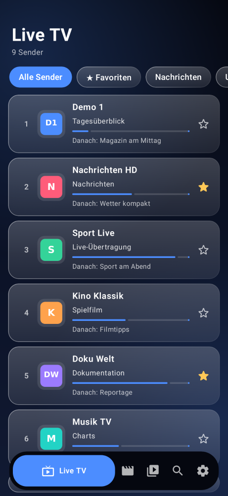
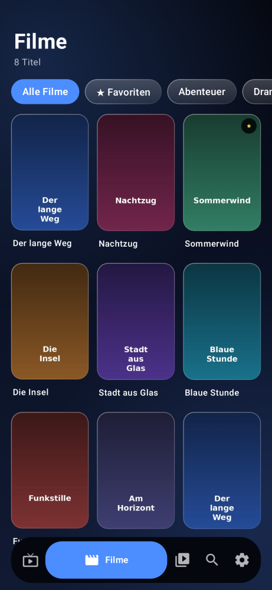
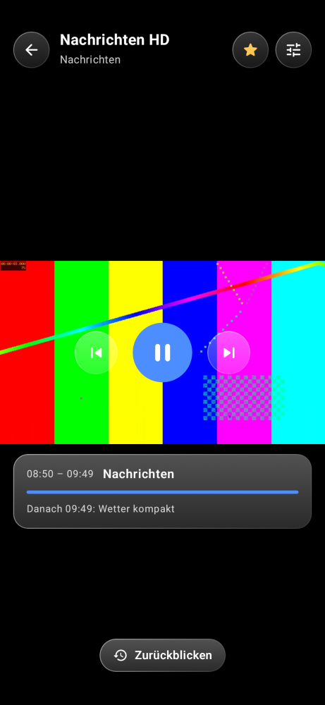
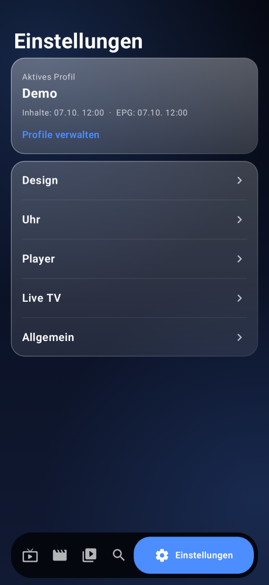

# IPTVstream

IPTV-Player für Android-Smartphones und Android TV / Fire TV.

**DG Studios** · [infos@dg-studios.de](mailto:infos@dg-studios.de)

Die App enthält keine Senderlisten. Sie spielt nur Live-TV, Filme und Serien von einem IPTV-Zugang, den du selbst einträgst (Xtream Codes oder M3U/M3U8).

## Screenshots

| Live TV | Filme | Player | Einstellungen |
|---|---|---|---|
|  |  |  |  |

Handy-Oberfläche im Glas-Look (Hintergrund „Mitternacht“, Akzent Blau) mit Demo-Inhalten. Die Bilder entstehen per JVM-Screenshot-Test (`./gradlew :mobile:recordPaparazziDebug`, Klasse `ReadmeScreenshots`).

## Download

| Gerät | APK |
|---|---|
| Smartphone / Tablet | [iptvstream-mobile.apk](https://github.com/daniel96865-a11y/iptvstream/releases/latest/download/iptvstream-mobile.apk) |
| Android TV / Fire TV | [iptvstream-tv.apk](https://github.com/daniel96865-a11y/iptvstream/releases/latest/download/iptvstream-tv.apk) |

Aktuelle Version: [Release v1.0.39](https://github.com/daniel96865-a11y/iptvstream/releases/tag/v1.0.39)

Installation außerhalb des Play Store: in den Android-Einstellungen „Unbekannte Apps“ für den Browser bzw. Dateimanager erlauben, die APK öffnen und installieren. Auf Fire TV die APK per „Downloader“ oder `adb install` aufspielen.

## Was die App kann

Zwei Oberflächen in einem Projekt:

| Modul | Zielgerät | Oberfläche |
|---|---|---|
| `:mobile` | Smartphone/Tablet | Glas-Look, untere Navigation als gleitende Kapsel (blendet beim Scrollen aus), Player in der aktuellen Ausrichtung |
| `:tv` | Android TV / Fire TV | Komplett per Fernbedienung, deutlicher Fokus, Zahleneingabe für Sender |
| `:core` | beide | Daten, Repository, EPG, Player, Einstellungen, ViewModels |

- Anmeldung per **Xtream Codes** (Server, Benutzer, Passwort) oder **M3U/M3U8**. Mehrere Profile, bearbeiten und löschen. Nach dem Login werden die Inhalte automatisch geladen.
- **Vom Handy an den Fernseher:** Auf dem TV „Mit Handy übertragen“. QR-Code scannen und die Zugangsdaten im Browser eintragen, oder in der Handy-App bei einem gespeicherten Profil „An TV senden“ und den kurzen Code eintippen. Die Adresse des Fernsehers steht unter dem Code. Die Zugangsdaten bleiben im eigenen WLAN.
- Live-TV, Filme, Serien, Kategorien, Favoriten, Suche, zuletzt gesehen.
- **Zurückblicken** (Catch-up/Timeshift) bei Sendern mit Archiv: vergangene Sendungen direkt aus dem Player abspielen.
- **Favoriten-Widget** für den Startbildschirm (Handy): Lieblingssender mit Logo und aktuellem Programm, Tippen startet den Sender.
- **EPG** (Xtream/XMLTV): lokal zwischengespeichert, sofort sichtbar, Aktualisierung im Hintergrund, manuell mit Fortschritt, Zuordnung auch bei HD/FHD/4K-Namen, das Land des Senders muss zum EPG-Eintrag passen. Für deutsche Sender gibt es zusätzlich einen kostenlosen deutschen Programmführer aus dem Netz (Einstellungen, Live-TV: „Als Ersatz“, „Bevorzugt“ oder „Aus“).
- Live-TV: Sendernummer, Logo, Jetzt/Danach mit Fortschritt, letzter Sender, gemerkte Listenposition (auch nach Neustart). Die Programminfo der sichtbaren Sender kommt aus dem Speicher (vorab geladen für die ersten Sender und die nächsten zwölf Stunden, der Rest beim Anzeigen), Logos und Poster werden in der Anzeigegröße geladen.
- Filme und Serien: Details, Fortsetzen, Fortschritt, nächste Episode. Die Filmlänge steht in Stunden und Minuten. Steht im Katalog nur „1 Min.“, liest die App die Länge aus der Datei.
- Player (Media3/ExoPlayer): HLS, TS, MP4, MKV, Audio- und Untertitelspuren, automatische Audiospur (Deutsch, Polnisch oder automatisch) mit Fallback, Decoder-Fallback, Passthrough (standardmäßig aus), Stereo-Fallback, Bildmodi, automatisches Wiederverbinden. In der Infoleiste stehen Auflösung, Bildformat und Tonformat so, wie der laufende Stream sie meldet. Sechs Audiokanäle sind Surround (5.1), keine Sprachen. Die Sprache der Tonspur wählt man in den Player-Einstellungen. AC3, E-AC3, MP2 und DTS werden bei Bedarf per FFmpeg dekodiert; das Bild bleibt beim Hardware-Decoder, auch bei 4K. Leise Sender lassen sich im Player unter „Ton lauter“ anheben (Leicht, Stark, Sehr stark). Die Stufe gilt nur für diesen Sender, Film oder diese Serie und bleibt gespeichert. Bei Audio-Passthrough bleibt der Ton unverändert. Fehlt ein Live-Sender als MPEG-TS, wird einmal HLS probiert, und umgekehrt. Unten am Live-Sender zeigt ein Balken, wie viel vom Puffer schon geladen ist. Klein ist ein kurzer Balken (etwa 15 Sekunden), groß ein langer (bis zu 90). Der Player bleibt dafür weiter hinter der Live-Sendung, statt den Puffer wieder auf wenige Sekunden zu kürzen.
- Handy-Player: startet in der aktuellen Ausrichtung. Querformat nur, wenn das Gerät gedreht wird und die Autorotation an ist. Ist die Autorotation aus, bleibt Hochformat, ein Knopf schaltet auf Vollbild.
- **Chromecast** (Handy): im Player auf das Cast-Symbol tippen und den Fernseher wählen. Live läuft dort am Live-Rand, Filme und Serien starten an der aktuellen Stelle, der nächste Sender oder Film läuft automatisch mit. An und aus in den Einstellungen, Player: „Chromecast“.
- Updates in der App: beim Start, höchstens alle vier Stunden, und in den Einstellungen über „Nach Updates suchen“. Neuere Versionen zeigen den Changelog; die APK wird geladen und mit dem System-Installer installiert.
- Einstellungen: Design (Akzent, Hintergrund, Glass-Stärke, Animationen, Dunkel/Hell), Uhr, Player, Live-TV, Allgemein inklusive Version. Auf dem Handy stehen die Bereiche untereinander. Tippen öffnet eine Glas-Schublade mit den Optionen, nur so hoch wie nötig. Alles bleibt gespeichert. Sind Animationen an, gleiten Fortschritt, Fokus, Filmdetails und der Spul-Hinweis. Aus heißt: alles steht sofort.

## Updates

Öffentliche Feeds auf `main`:

- https://raw.githubusercontent.com/daniel96865-a11y/iptvstream/main/docs/iptvstream-mobile.json
- https://raw.githubusercontent.com/daniel96865-a11y/iptvstream/main/docs/iptvstream-tv.json

Felder: `versionCode`, `versionName`, `apkUrl`, `changelog`. `apkUrl` zeigt auf die Release-Dateien `iptvstream-mobile.apk` und `iptvstream-tv.apk`. Tags mit Bindestrich (z. B. `v1.0.15-beta1`) werden als Vorabversion (Pre-release) veröffentlicht und ändern die Feeds nicht. Bei einem normalen Tag `v*` aktualisiert GitHub Actions diese Dateien auf `main`, falls die gebaute Version noch nicht eingetragen ist (`scripts/update-feeds.sh`).

Der Glas-Look auf dem Handy sind halbtransparente, getönte Flächen mit Rand und Verlauf.

## Anmeldung vom Handy auf den Fernseher

Auf dem Fernseher bei der Anmeldung **Mit Handy übertragen** wählen. Es erscheinen ein QR-Code und ein kurzer Code (etwa zehn Minuten gültig, nur einmal).

- **QR-Code:** Mit der Handy-Kamera scannen. Es öffnet sich eine Seite im Browser. Dort Server, Benutzer und Passwort bzw. die M3U-Adresse eintragen, inklusive EPG-Adresse, falls vorhanden. Wenn die App installiert ist, kann man von derselben Seite ein gespeichertes Profil senden.
- **Code:** In der Handy-App beim Profil auf **An TV senden** tippen und den Code vom Fernseher eingeben. Die Suche läuft im eigenen WLAN. Die Adresse unter dem Code kann man eintippen, wenn die Suche nichts findet. Die Punkte zwischen den Zahlen setzt die App.

Handy und Fernseher müssen im selben WLAN sein. Es wird kein Cloud-Dienst benutzt. Der Fernseher nimmt die Daten nur aus dem eigenen Netz an und verwirft sie nach der Übertragung oder nach Ablauf der Zeit. Zugangsdaten werden nicht protokolliert.

Technisch startet der Fernseher dafür einen kleinen lokalen Webserver und bindet ihn an seine WLAN-Adresse. Der QR-Code enthält `http://<IP-des-Fernsehers>:<Port>/?token=…` mit einem einmaligen Token. Die App findet den Fernseher über den kurzen Code (mDNS und eine Suche im eigenen Subnetz) oder über die angezeigte Adresse.

## TV-Bedienung

- **Oben:** Tab-Leiste. Fokus wählt den Tab. ↓ springt in die offene Kategorienliste links; ist sie zu, in die Sender oder Filme. → öffnet die Inhalte der Kategorie, ← kehrt aus der Liste zu den Kategorien zurück. Zurück springt zur Tab-Leiste. Ein langer Kategoriename läuft durch, solange der Fokus auf der Zeile steht. Kurze Namen und die übrigen Zeilen bleiben stehen.
- **Live-Liste:** OK spielt ab. Lange OK oder die Menü-Taste setzt einen Favoriten oder den Startsender. Zifferntasten geben die Sendernummer ein, OK bestätigt sofort.
- **Player Live:** ▲/▼ oder Kanal-Tasten wechseln den Sender. ► oder Menü öffnet die Einstellungen (Ton lauter, Audio, Untertitel, Bildmodus, Favorit). OK zeigt die Info. Zifferntasten springen direkt zum Sender.
- **Player Film/Serie:** ◄/► spult ±10 Sekunden (gehalten schneller). OK pausiert. ▼ oder Menü öffnet die Einstellungen. Zurück beendet die Wiedergabe.

## Bauen

Voraussetzungen: JDK 17, Android SDK (Plattform 35, Build-Tools 35). Mindestversion der App: Android 7.0 (API 24), damit die Release-Signatur nur APK Signature Scheme v2 und v3 braucht.

```bash
./gradlew :mobile:assembleRelease :tv:assembleRelease
```

Ohne Signatur-Variablen werden die Release-APKs mit dem Debug-Schlüssel signiert, damit sie lokal installierbar bleiben:

```text
mobile/build/outputs/apk/release/mobile-release.apk
tv/build/outputs/apk/release/tv-release.apk
```

Für eine Release-Signatur (v2 und v3) diese Umgebungsvariablen oder Gradle-Properties setzen:

| Variable | Bedeutung |
|---|---|
| `SIGNING_KEYSTORE_BASE64` | PKCS12-Keystore, Base64-kodiert. Der Build dekodiert es in eine temporäre Datei und signiert damit. |
| `SIGNING_STORE_PASSWORD` | Keystore-Passwort |
| `SIGNING_KEY_PASSWORD` | Schlüssel-Passwort |
| `SIGNING_KEY_ALIAS` | Schlüsselalias |

Beispiel:

```bash
export SIGNING_KEYSTORE_BASE64="$(base64 -w0 release.keystore)"
export SIGNING_STORE_PASSWORD="…"
export SIGNING_KEY_PASSWORD="…"
export SIGNING_KEY_ALIAS="iptvstream"
./gradlew :mobile:assembleRelease :tv:assembleRelease
```

Keystore-Dateien (`*.jks`, `*.keystore`) gehören nicht ins Repository.

GitHub Actions (`.github/workflows/build.yml`) baut beide APKs bei jedem Push, lädt sie als Artefakt hoch und hängt sie bei Tags `v*` an ein GitHub-Release (`iptvstream-mobile.apk`, `iptvstream-tv.apk`). Danach werden die Update-Feeds auf `main` nachgezogen. In CI werden die vier Variablen aus den Repository-Secrets gelesen; das Keystore wird vor dem Build dekodiert.

## Pakete

| Modul | applicationId / Namespace |
|---|---|
| `:mobile` | `de.dgstudios.iptvstream` |
| `:tv` | `de.dgstudios.iptvstream.tv` |
| `:core` | `de.dgstudios.iptvstream.core` |
